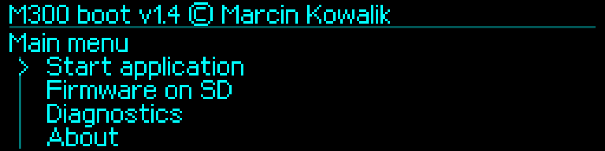
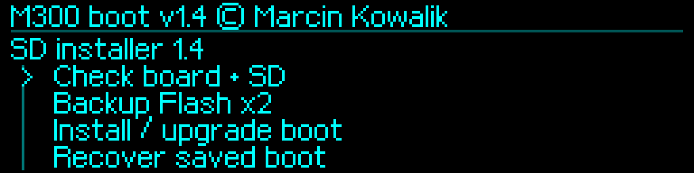

# M300Boot 1.4 — classic Zortrax M300

[English](README.md) · [Polski](README_PL.md)

Independent service bootloader by **Marcin Kowalik** · mkowalik@agh.edu.pl. Target: **classic M300, HW05 / PCB Rev.5.3 / STM32F103-family / measured 256 KiB Flash**. Both permanent BOOT and SD installer identify as **1.4**.

Exactly five UART rates: **115200, 250000, 500000, 750000, 1500000**, 8N1. Default **250000**, UART on bootwait **OFF**. Supported saved choices survive upgrade. Old unsupported records fall back to 250000 in BOOT; explicitly save 250000 before launching an older APP that independently reads those records.

## Download and installation order

| Current state | Package |
|---|---|
| Recognized custom M300Boot | [SD_UPGRADE](firmware/v1.4/M300Boot_v1.4_SD_UPGRADE.zip) |
| Qualified original OEMv3 | [SD_FACTORY_OEMV3](firmware/v1.4/M300Boot_v1.4_SD_FACTORY_OEMV3.zip) |
| SWD reads working, RDP already off | [STLINK — two addressed segments](firmware/v1.4/M300Boot_v1.4_STLINK.zip) |

[Release 1.4](https://github.com/MarcinKowalik-AGH/Zortrax-m300-Boot-Loader/releases/tag/v1.4) · [SHA-256](firmware/v1.4/SHA256SUMS.txt) · [Full English instructions](docs/en/v1.4/README.md).

**SD order:** preserve independent backups → install and launch the intermediary → check board/card → create and verify two Flash backups → separately confirm BOOT replacement → restart into BOOT 1.4 → explicitly restore the intended stock or Klipper APP. [Step-by-step guide](docs/en/v1.4/installation.md).

The screenshots are generated renders, not photographs. The 1.4 build is checked offline; physical acceptance on the printer remains to be completed. Earlier hardware reports concern 1.3.1. [Validation and limitations](docs/en/v1.4/validation.md) · [Hardware scope](docs/en/v1.4/tested-hardware.md).

## Use and recovery

- [Preserve original memory](docs/en/v1.4/original-backup.md)
- [Menus and console](docs/en/v1.4/features-and-console.md)
- [UART settings and migration](docs/en/v1.4/uart-examples.md)
- [ST-Link addresses and complete readback](docs/en/v1.4/stlink-and-recovery.md)
- [Troubleshooting](docs/en/v1.4/troubleshooting.md)
- [Public tools](tools/README.md) · [Downloads](firmware/README.md) · [Changelog](CHANGELOG.md)

BOOT stage2 occupies **0x08001000–0x08007FFF**; assets **0x0803A000–0x0803CFFF**. ST-Link preserves APP. SD migration temporarily replaces APP and requires restoration. Original first 4 KiB, manufacturer NVM, device checks and protected settings remain. No automatic power-loss BOOT rollback is provided. Do not remove active RDP to obtain a backup.

`RESTORE.BIN` remains original **Zortrax M300 1.3.1**. Independent backup diagnostic remains **0.5.5**. Klipper MCU/host is a separate package. Their different version numbers are intentional.

[All documentation and archives](docs/en/README.md) · [Archived 1.3.1](docs/en/v1.3.1/README.md) · [Archived 1.1](docs/en/v1.1/README.md). Binary firmware, host tools and manuals are public; private firmware sources, OEM-key tools and personal Flash/identity data are excluded. [Distribution notices](THIRD_PARTY_NOTICES.md). Classic M300 only; Plus, Dual and Inventure are separate targets.
