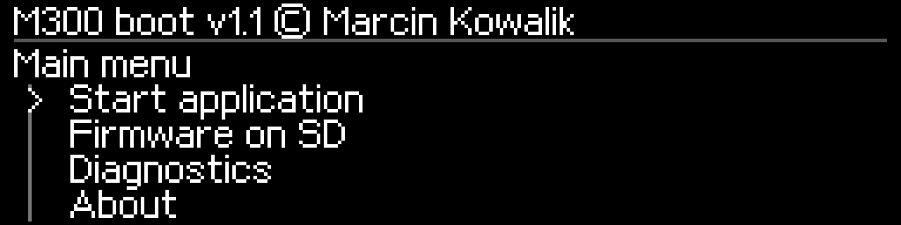

# M300 boot v1.1 — classic Zortrax M300

**Independent service bootloader · SD installer 1.1-i4**  
**Autor / Author:** Marcin Kowalik · mkowalik@agh.edu.pl  
**Fully characterized test unit:** classic M300, **PCB Rev. 5.3 / hardware 05 / measured 256 KiB Flash**. A second printer has owner-reported FACTORY success; its board revision and firmware have not yet been supplied.

> **Najpierw kopia / Backup first.** Nie zdejmuj RDP, żeby odczytać pamięć: wyłączenie aktywnej ochrony w tym STM32F1 kasuje główną Flash. Najpierw zachowaj dwie zgodne kopie bootloadera, NVM/danych fabrycznych, UID, SIZE i Option Bytes. [Pełna procedura PL](docs/v1.1/KOPIA_ORYGINALU_PL.md) · [English](docs/v1.1/ORIGINAL_BACKUP_EN.md).

> **Ważne ograniczenie / Important restriction:** opublikowane, niezmienione pakiety i4 są **przypisane do jednego zakwalifikowanego egzemplarza** przez hashe UID, opcji i strony fabrycznej. Sama zgodność „M300 / HW05” nie wystarcza. Nie zdejmuj tych blokad i nie wgrywaj pośrednika na inną drukarkę, żeby sprawdzić, czy odmówi. / The unchanged i4 installers are **single-device-profile locked**. They are not universal M300 installers. A different unit requires its own qualification and build, not patched hash checks. See [tested hardware and compatibility](docs/v1.1/TESTED_HARDWARE.md).

## Pobierz / Download v1.1

| Stan urządzenia / Current state | Pakiet / Package |
|---|---|
| Rozpoznany oryginalny **Zortrax Bootloader v3**, profil zgodny / recognized factory OEM v3, matching profile | **[SD_FACTORY_OEMV3_i4](firmware/v1.1/M300Boot_v1.1_SD_FACTORY_OEMV3_i4.zip)** |
| Rozpoznany własny M300Boot FULL rc1/rc2/rc3 lub v1.1, profil zgodny / recognized custom FULL, matching profile | **[SD_UPGRADE_i4](firmware/v1.1/M300Boot_v1.1_SD_UPGRADE_i4.zip)** |
| Świadoma procedura ST-Link/SWD z własną kopią / deliberate SWD installation or recovery using your private backup | **[STLINK — obrazy i lokalny generator / images and offline builder](firmware/v1.1/M300Boot_v1.1_STLINK_LOCAL_BUILDER.zip)** |
| Zabezpieczenie oryginalnego bootloadera i danych przy RDP / original boot and data backup under RDP | **[Diagnostyka UART 0.5.5 / UART backup application](firmware/v1.1/M300_BACKUP_0.5.5_UART.zip)** |

**[Instrukcja instalacji PL](docs/v1.1/INSTALACJA_PL.md)** · **[Installation manual EN](docs/v1.1/INSTALLATION_EN.md)**  
[ST-Link i odzyskiwanie PL](docs/v1.1/STLINK_I_ODZYSKIWANIE_PL.md) · [ST-Link and recovery EN](docs/v1.1/STLINK_AND_RECOVERY_EN.md)  
[Funkcje, Hardware i konsola PL](docs/v1.1/FUNKCJE_I_KONSOLA_PL.md) · [Features and console EN](docs/v1.1/FEATURES_AND_CONSOLE_EN.md)  
[Manifest wydania / Release manifest](docs/v1.1/RELEASE_MANIFEST.md) · [SHA-256](firmware/v1.1/SHA256SUMS.txt)

## Dokumentacja według wersji / Versioned documentation

**[Wszystkie instrukcje v1.1 / Complete v1.1 manuals](docs/v1.1/README.md)** · [Indeks dokumentacji](docs/README.md) · [GitHub Release v1.1](https://github.com/MarcinKowalik-AGH/Zortrax-m300-Boot-Loader/releases/tag/v1.1)

| Wersja | Status | Dokumentacja | Pliki |
|---|---|---|---|
| **v1.1 / i4** | **Aktualna / Current** | [docs/v1.1](docs/v1.1/README.md) | [firmware/v1.1](firmware/v1.1) |

[Przykłady UART i aktualizacji APP PL](docs/v1.1/KONSOLA_UART_PRZYKLADY_PL.md) · [UART examples EN](docs/v1.1/UART_EXAMPLES_EN.md) · [Niezależny audyt publikacji](docs/v1.1/AUDYT_REPOZYTORIUM_PL.md) · [Publiczne narzędzia PC](tools/README.md)

**Tag `v1.1` zachowuje pierwotne pliki wydania; na gałęzi `main` aktualizujemy dokumentację i testy publikacyjne, bez zmian przetestowanych binariów.** Nie tworzono nieistniejącego publicznego archiwum v1.0. Kompatybilne odsyłacze z historycznych `docs/*.md` zachowano.

## Co robi / Features

- Nagłówek **M300 boot v1.1 © Marcin Kowalik**; czytelne menu OLED, `Back`, brak zawijania na końcu, płynne przewijanie z częściową aktualizacją ekranu.
- **Diagnostics → Hardware**: hardware revision, serial number and accumulated operating time decoded from the printer, not a fixed `OK`. The model label is the M300 target profile, not an independently detected marketing model.
- Pierścień postępu z procentami / progress ring with percentages for measured operations; neutral indication for indeterminate waits.
- 5-second cancellable autoboot, manual boot, firmware selection on SD, image verification, SD/UART application updates and identical-image skip.
- UART: **19200 / 57600 / 115200 / 250000 / 500000, 8N1**, persisted selection, recovery entry at 250000 by holding the encoder during startup.
- Full-Flash and identity backup; service diagnostics and history. The SD installer makes **two independent 256-KiB snapshots** and requires a separate physical confirmation before replacing boot pages.

*Ilustracje są renderami kodu interfejsu, nie zdjęciami potwierdzającymi test sprzętowy. / Illustrations are UI renders, not hardware-test photographs.*

## Potwierdzenie sprzętowe / Hardware status

**UPGRADE:** właściciel potwierdził instalację v1.1/i4 i uruchomienie oryginalnego **Zortrax 1.3.1** na pierwszej, dokładnie scharakteryzowanej M300 (Rev. 5.3 / HW05 / 256 KiB). **FACTORY:** właściciel następnie zgłosił, że ścieżka FACTORY działa na **drugiej drukarce**. Parametry tej płyty, log i dokładny punkt zakończenia instalacji nie zostały podane; przy deklarowanych blokadach UID/Option Bytes/strony fabrycznej wymaga to dodatkowej weryfikacji. **ST-Link pozostaje niepotwierdzony sprzętowo.**

Owner reports **UPGRADE and restored stock 1.3.1 startup** on unit A, plus **FACTORY functioning on a second printer** (unit B). This second report is recorded as owner evidence, **not** proof of universal compatibility or of specific permanent-write/stock-start checkpoints without logs. The embedded identity gates have not been removed. [Hardware feedback and test matrix](docs/v1.1/HARDWARE_FEEDBACK_2026-10-29.md) · [Tested hardware](docs/v1.1/TESTED_HARDWARE.md). No power-loss or general print-performance certification is claimed.

## Mapa pamięci / Memory layout

The original **first 4 KiB at 0x08000000 are preserved**. The custom second stage occupies `0x08001000–0x08007FFF`; assets occupy `0x0803A000–0x0803CFFF`. One replaceable application slot starts at `0x08008000` and has **200 KiB** capacity. Own metadata/journal use `0x0803D000–0x0803DFFF`. The final **8 KiB at 0x0803E000–0x0803FFFF** are outside normal bootloader write APIs.

**There is no standalone public “32 KiB at 0x08000000” image.** The ST-Link archive contains two address-specific components and a sparse HEX. A complete personal recovery image is assembled **offline from your own verified backup**. Do not flash an encrypted `Update.bin` with ST-Link.

## Zakres publikacji / Publication scope

Following the Inventure publication model: binaries, public host tools, PL/EN documentation, checksums and selected UI previews. **No C/ASM firmware source, ELF/map/disassembly, raw UID, serial-bearing screenshots, full personal Flash/NVM dumps, cryptographic key tools or complete private recovery image are published.** Installer identity hashes remain embedded to preserve the tested safety gate.

`RESTORE.BIN` contains the original **Zortrax M300 1.3.1** application and retains manufacturer rights. MIT licensing applies to newly authored material, not manufacturer firmware/assets. See [third-party notice](THIRD_PARTY_NOTICES.md).

**Independent project; not affiliated with or endorsed by Zortrax or STMicroelectronics. Keep a verified private backup on a second physical medium.**
