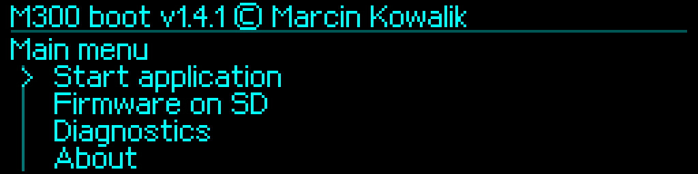
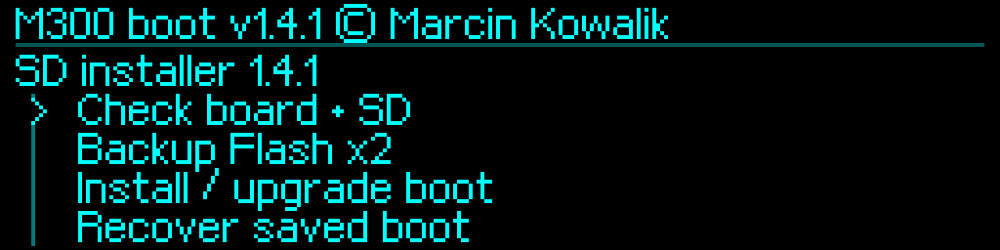

# M300Boot 1.4.1 — classic Zortrax M300

[English](README.md) · [Polski](README_PL.md)

Independent service bootloader by **Marcin Kowalik** · mkowalik@agh.edu.pl. Target: **classic M300, HW05 / PCB Rev.5.3 / STM32F103-family / measured 256 KiB Flash**. Both permanent BOOT and SD installer identify as **1.4.1**.

Exactly five UART rates: **115200, 250000, 500000, 750000, 1500000**, 8N1. Default **250000**, UART on bootwait **OFF**. Supported saved choices survive upgrade. Old unsupported records fall back to 250000 in BOOT; explicitly save 250000 before launching an older APP that independently reads those records.

The distributed installers retain a device-specific UID / OEM-prefix / factory-data qualification. Matching the M300 model, HW05 or PCB Rev.5.3 alone does not qualify another printer; a profile refusal must be resolved from its own verified backup rather than bypassed.

## Download and installation order

| Current state | Package |
|---|---|
| Recognized custom M300Boot | [SD_UPGRADE](https://github.com/MarcinKowalik-AGH/Zortrax-m300-Boot-Loader/releases/download/v1.4.1/M300Boot_v1.4.1_SD_UPGRADE.zip) |
| Qualified original OEMv3 | [SD_FACTORY_OEMV3](https://github.com/MarcinKowalik-AGH/Zortrax-m300-Boot-Loader/releases/download/v1.4.1/M300Boot_v1.4.1_SD_FACTORY_OEMV3.zip) |
| SWD reads working, RDP already off | [STLINK — two addressed segments](https://github.com/MarcinKowalik-AGH/Zortrax-m300-Boot-Loader/releases/download/v1.4.1/M300Boot_v1.4.1_STLINK.zip) |

[Release 1.4.1](https://github.com/MarcinKowalik-AGH/Zortrax-m300-Boot-Loader/releases/tag/v1.4.1) · [SHA-256](firmware/v1.4.1/SHA256SUMS.txt) · [Full English instructions](docs/en/v1.4.1/README.md).

**SD order:** preserve independent backups → install and launch the intermediary → check board/card → create and verify two Flash backups → separately confirm BOOT replacement → restart into BOOT 1.4.1 → explicitly restore the intended stock or Klipper APP. [Step-by-step guide](docs/en/v1.4.1/installation.md).

The screenshots are generated from the 1.4.1 OLED code. **Field history: the owner reports about two weeks of use of baseline 1.4**, with all three installation routes already accepted on 2026-11-09. **The 1.4.1 firmware patch is new and has been validated offline on 2026-11-18; it has not accumulated two weeks of hardware testing.** [Hardware status](docs/reports/v1.4.1/HARDWARE_STATUS.json) · [Audit and validation](docs/en/v1.4.1/validation.md).

## What this final patch changes

- Restores a constrained retry after an interrupted APP metadata commit: the same verified candidate, matching complete Flash payload, a recognized torn record and physical consent are required. Ordinary boot still rejects an incomplete commit.
- Uses the existing unused space before the fixed OEM hook for the recovery checks; protected memory boundaries remain unchanged.
- Checks all existing service-card destinations before creating missing templates, and reliably closes UART logs after connection errors.
- Provides matching instructions inside the ST-Link ZIP, direct download links and complete English/Polish manuals.

**UART 1,000,000 and 10,000,000 are not selectable.** Removal of 1,000,000 was already present in 1.4 and is retained. The default remains 250000; keep the host and MCU settings matched.

## Use and recovery

- [Original Zortrax Bootloader v3 — 32-KiB binary, provenance and SHA-256](firmware/original/README.md)
- [Preserve original memory](docs/en/v1.4.1/original-backup.md)
- [Menus and console](docs/en/v1.4.1/features-and-console.md)
- [UART settings and migration](docs/en/v1.4.1/uart-examples.md)
- [ST-Link addresses and complete readback](docs/en/v1.4.1/stlink-and-recovery.md)
- [Troubleshooting](docs/en/v1.4.1/troubleshooting.md)
- [Public tools](tools/README.md) · [Downloads](firmware/README.md) · [Changelog](CHANGELOG.md)

BOOT stage2 occupies **0x08001000–0x08007FFF**; assets **0x0803A000–0x0803CFFF**. ST-Link preserves APP. SD migration temporarily replaces APP and requires restoration. Original first 4 KiB, manufacturer NVM, device checks and protected settings remain. No automatic power-loss BOOT rollback is provided. Do not remove active RDP to obtain a backup.

`RESTORE.BIN` remains original **Zortrax M300 1.3.1**. Independent backup diagnostic remains **0.5.5**. Klipper MCU/host is a separate package. Their different version numbers are intentional.

[All documentation and archives](docs/en/README.md) · [Archived 1.4](docs/en/v1.4/README.md) · [Archived 1.3.1](docs/en/v1.3.1/README.md) · [Archived 1.1](docs/en/v1.1/README.md). Binary firmware, host tools and manuals are public; private firmware sources, OEM-key tools and personal Flash/identity data are excluded. [Distribution notices](THIRD_PARTY_NOTICES.md). Classic M300 only; Plus, Dual and Inventure are separate targets.
