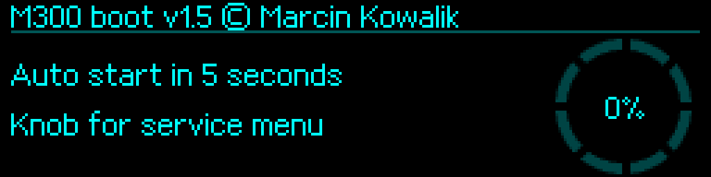
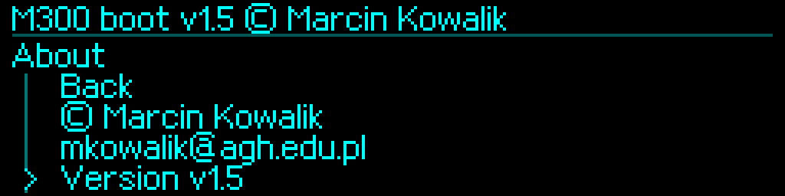
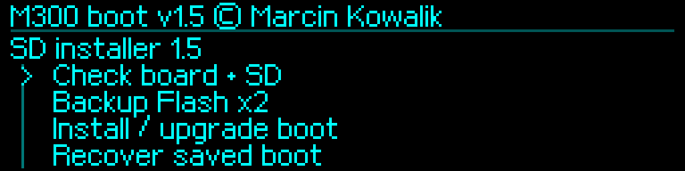

# M300Boot 1.5 — klasyczna Zortrax M300

[English](README.md) · [Polski](README_PL.md)

Niezależny bootloader serwisowy: **Marcin Kowalik** · mkowalik@agh.edu.pl. Cel: **klasyczna M300, HW05 / PCB Rev.5.3 / rodzina STM32F103 / zmierzone 256 KiB Flash**. Stały BOOT i instalator SD mają numer **1.5**.

Dokładnie pięć prędkości UART: **115200, 250000, 500000, 750000, 1500000**, 8N1. Domyślnie **250000**, UART on bootwait **OFF**. Obsługiwane zapisy pozostają po aktualizacji. Dawne niedozwolone rekordy dają w BOOT 250000; przed starszą APP samodzielnie odczytującą te rekordy jawnie zapisz 250000.

Udostępnione instalatory zachowują kwalifikację konkretnego egzemplarza według UID, prefiksu OEM i danych fabrycznych. Sama zgodność modelu M300, HW05 lub PCB Rev.5.3 nie kwalifikuje innej drukarki; odmowę profilu trzeba wyjaśnić na podstawie jej własnej zweryfikowanej kopii, bez omijania kontroli.

## Pobieranie i kolejność instalacji

| Stan urządzenia | Paczka |
|---|---|
| Rozpoznany własny M300Boot | [SD_UPGRADE](https://github.com/MarcinKowalik-AGH/Zortrax-m300-Boot-Loader/releases/download/v1.5/M300Boot_v1.5_SD_UPGRADE.zip) |
| Zakwalifikowany oryginalny OEMv3 | [SD_FACTORY_OEMV3](https://github.com/MarcinKowalik-AGH/Zortrax-m300-Boot-Loader/releases/download/v1.5/M300Boot_v1.5_SD_FACTORY_OEMV3.zip) |
| Działający odczyt SWD, RDP już wyłączone | [STLINK — dwa adresowane segmenty](https://github.com/MarcinKowalik-AGH/Zortrax-m300-Boot-Loader/releases/download/v1.5/M300Boot_v1.5_STLINK.zip) |

[Wydanie 1.5](https://github.com/MarcinKowalik-AGH/Zortrax-m300-Boot-Loader/releases/tag/v1.5) · [SHA-256](firmware/v1.5/SHA256SUMS.txt) · [Pełne instrukcje po polsku](docs/pl/v1.5/README.md).

**Kolejność SD:** zachowaj niezależne kopie → wgraj i uruchom instalator pośredni → sprawdź płytę/kartę → wykonaj i zweryfikuj dwie kopie Flash → osobno potwierdź zastąpienie BOOT → uruchom BOOT 1.5 → jawnie przywróć docelową APP stock lub Klipper. [Instrukcja krok po kroku](docs/pl/v1.5/installation.md).

Ilustracje powstały z kodu OLED 1.5. **Historia użytkowania: według zgłoszenia właściciela baza 1.4 działała około dwóch tygodni**; odbiór wszystkich trzech metod instalacji zapisano już 09.11.2026. **Binaria 1.5 zachowują poprawki audytu 1.4.1, mają nowy numer wersji i własne kontrole programowe. Nie mają dwóch tygodni testów tej kompilacji na sprzęcie.** [Status testów](docs/reports/v1.5/HARDWARE_STATUS.json) · [Audyt i walidacja](docs/pl/v1.5/validation.md).

## Co zawiera wydanie 1.5

Zachowano poprawki APP/hosta z audytu 1.4.1. Ekran startowy BOOT, About, instalator SD i UART zgłaszają **1.5**; komenda instalatora to `INSTALL V15`. Wydanie 1.4.1 pozostaje dostępne w archiwum.

- Umożliwia ograniczone ponowienie po przerwanym zatwierdzaniu metadanych APP: wymagane są ten sam zweryfikowany pakiet, zgodny pełny payload we Flash, rozpoznany niepełny rekord oraz fizyczna zgoda. Zwykły rozruch nadal odrzuca niepełny commit.
- Wykorzystuje wolne miejsce przed stałym punktem wejścia OEM na kontrole odzyskiwania; granice chronionych obszarów pozostają zachowane.
- Sprawdza wszystkie istniejące pliki karty serwisowej przed tworzeniem brakujących szablonów i zamyka logi UART również po błędzie połączenia.
- Udostępnia zgodne instrukcje wewnątrz ZIP-a ST-Link, bezpośrednie linki pobierania i komplet opisów PL/EN.

**UART 1 000 000 i 10 000 000 nie są dostępne do wyboru.** Usunięcie 1 000 000 było już w 1.4 i pozostaje zachowane. Domyślna prędkość to nadal 250000; ustawienia hosta i MCU muszą się zgadzać.

## Obsługa i odzyskiwanie

- [Oryginalny Zortrax Bootloader v3 — plik 32 KiB, pochodzenie i SHA-256](firmware/original/README_PL.md)
- [Zachowanie oryginalnej pamięci](docs/pl/v1.5/original-backup.md)
- [Menu i konsola](docs/pl/v1.5/features-and-console.md)
- [Ustawienia i migracja UART](docs/pl/v1.5/uart-examples.md)
- [Adresy ST-Link i pełny odczyt kontrolny](docs/pl/v1.5/stlink-and-recovery.md)
- [Rozwiązywanie problemów](docs/pl/v1.5/troubleshooting.md)
- [Narzędzia hosta](tools/README_PL.md) · [Pobieranie](firmware/README_PL.md) · [Historia zmian](docs/pl/changelog.md)

Stage2 BOOT zajmuje **0x08001000–0x08007FFF**; zasoby **0x0803A000–0x0803CFFF**. ST-Link zachowuje APP. Instalacja SD chwilowo zastępuje APP i wymaga jej przywrócenia. Oryginalne pierwsze 4 KiB, NVM producenta, kontrole urządzenia i chronione ustawienia pozostają zachowane. Nie ma automatycznego cofania BOOT po zaniku zasilania. Nie usuwaj aktywnego RDP w celu wykonania kopii.

`RESTORE.BIN` nadal zawiera oryginalny **Zortrax M300 1.3.1**. Niezależna diagnostyka kopii zachowuje **0.5.5**. MCU/host Klippera to osobna paczka. Różne numery tych składników są celowe.

[Cała dokumentacja i archiwum](docs/pl/README.md) · [Archiwalne 1.4.1](docs/pl/v1.4.1/README.md) · [Archiwalne 1.4](docs/pl/v1.4/README.md) · [Archiwalne 1.3.1](docs/pl/v1.3.1/README.md) · [Archiwalne 1.1](docs/pl/v1.1/README.md). Publiczne są binaria, narzędzia hosta i instrukcje; prywatne źródła firmware, narzędzia kluczy OEM i dane Flash/tożsamości pozostają wyłączone. [Zasady dystrybucji](THIRD_PARTY_NOTICES.md). Klasyczna M300; Plus, Dual i Inventure są osobnymi celami.
