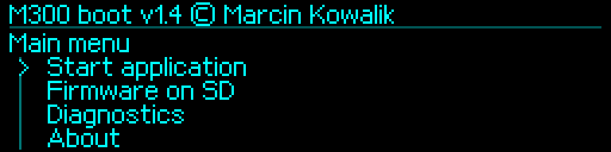

# Features and console — M300Boot 1.4

[English](../../en/v1.4/features-and-console.md) · [Polski](../../pl/v1.4/features-and-console.md) · [Index](README.md)

## Menu and startup

The permanent bootloader and SD intermediary identify as **1.4**, without development suffixes. The OEM update container has a separate technical wrapper version. The OLED remains native 256×64 with stock-style font, direct encoder detents, bounded scrolling and pinned Back. Identical frames are skipped and only changed rectangles are transferred.

| Main entry | Purpose |
|---|---|
| Start application | Verify and launch the installed APP |
| Firmware on SD | Choose, check and install an APP package |
| Diagnostics | Flash, Hardware, Reset/Recovery, encoder, display, UART, SD and history |
| About | Author and version |
| Restart | Reset the controller |
| Backup Flash | Explicit backup to prepared files |
| Service history | Read history or explicitly save it to SD |

The five-second countdown starts after initialization. A physical knob action can enter service. With bootwait OFF, host RX cannot interrupt countdown. With ON, only complete recognized diagnostic lines can enter service; binary, partial or overlong traffic does not postpone the deadline. Holding the knob at power-on temporarily selects recovery 250000.

## UART and persistence

Exactly **115200, 250000, 500000, 750000, 1500000**, default **250000/OFF**. Changes wait for old-speed TX completion and require verified Flash readback. The settings journals are append-only; no automatic reclaim erases occur. Re-selecting a genuine stored current value does not consume a slot. Old unsupported rates use active fallback 250000 without silently changing the journal. Explicitly save 250000 before launching an old APP that could still interpret a removed record. [Full UART procedure](uart-examples.md).

## Installation and diagnostics

APP packages use one slot at **0x08008000**; BOOT replacement is a separate installer operation. APP writes/manual launch require a fresh 2-second hold; BOOT replacement requires verified double backups and the separate release/click/release/5-second gesture. Manufacturer NVM, original first 4 KiB and Option Bytes remain outside normal write targets. [Installation order](installation.md).

Console diagnostics include INFO, PING, HELP, VERIFY, CARDINFO, DISPLAY, DIAG and fixed-region DUMP. BACKUP/LOGSAVE explicitly write SD; BOOT/REBOOT change controller state. Use `ibtool.py` for M3B inspect/pack/check/update. `serial` without `--update` verifies only; explicit update still needs physical confirmation. M3B provides SHA-256 integrity, not signature authentication. Standalone Klipper screens belong to its MCU APP and are supplied by the separate Klipper package.
