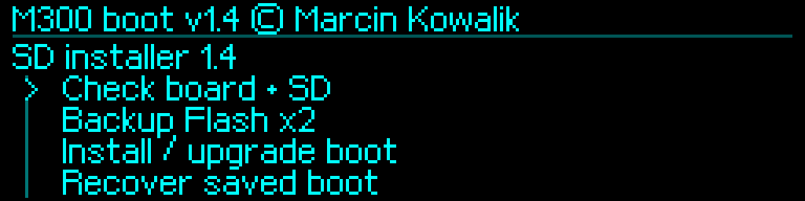
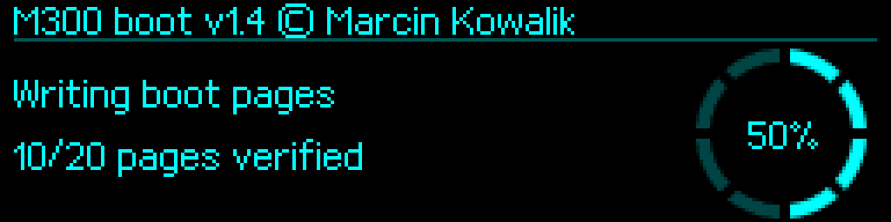
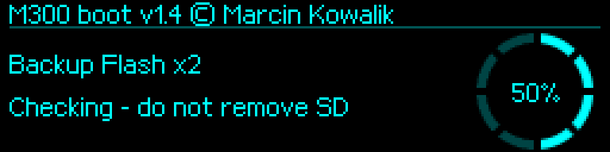
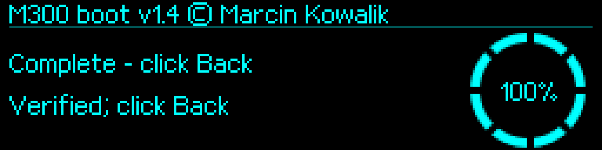

# SD installation — M300Boot 1.4

[English](../../en/v1.4/installation.md) · [Polski](../../pl/v1.4/installation.md) · [Index](README.md)

## Choose the route

Use **UPGRADE** from a recognized custom M300Boot, or **FACTORY** from the qualified original OEM v3. Use the corresponding archive from [firmware/v1.4](../../../firmware/v1.4). Existing UID/options/factory/profile and source checks remain mandatory. Stop Klipper and other UART clients before servicing.

## Prepare and verify the card

1. First complete [independent backups](original-backup.md) and copy them to another medium.
2. Verify the downloaded ZIP with [this release's SHA-256 list](../../../firmware/v1.4/SHA256SUMS.txt). Extract into a new folder.
3. Copy exactly six files to a fresh FAT32 card:

| Route | Files at card root |
|---|---|
| UPGRADE | `M300APP.M3B`, `RESTORE.BIN`, `M3FLASH.BIN`, `M3INFO.BIN`, `ZBACK2.BIN`, `ZINFO2.DAT` |
| FACTORY | `Update.bin`, `RESTORE.BIN`, `M3FLASH.BIN`, `M3INFO.BIN`, `ZBACK2.BIN`, `ZINFO2.DAT` |

The four A5-filled template files are not backups: Flash files are 262144 B each, information files 1024 B each. Never overwrite completed backups with templates. Do not put the FACTORY `Update.bin` and the intermediary M3B on the same card.

```sh
python3 tools/verify_sd_i2.py --card "/Volumes/M300_CARD" --route upgrade
# Use --route factory for the FACTORY card.
```

Require a successful 1.4 card check. The printer installer separately checks FAT cluster separation before writes.

## Install and launch the intermediary

**UPGRADE:** interrupt countdown with the knob; release it. Select `Firmware on SD → Choose firmware file → M300APP.M3B`, check and install it with the fresh 2-second hold. Verify Flash. Select `Start application → Launch application` and confirm. APP now contains **SD installer 1.4**; permanent BOOT has not yet been updated.

**FACTORY:** power off and insert the FACTORY card. OEM may program `Update.bin` immediately at power-on. Wait for completion, switch off, remove the card and boot without it. Require **SD installer 1.4**. The container's technical OEM wrapper version is independent of the running installer's 1.4 identity. Reinsert the same card in the stable installer menu.



## Complete the BOOT transaction

1. `Check board + SD` → require `CHECK_SOURCE_CARD_RESTORE_OK`.
2. `Backup Flash x2` → require `PASS_SD_FULL_FLASH_X2` in the same session.
3. `Install / upgrade boot` → **release → fresh click → release → fresh press and hold 5 s**. Rotation cancels.
4. Require `INSTALL_OK_STAGE2_AND_ASSETS_VERIFIED`. Preserve a refusal and its error; do not remove a guard or change identity hashes.
5. `Restart to boot`; interrupt countdown. Require version **1.4** in BOOT.
6. Copy all four completed backup files elsewhere and check them with `python3 tools/verify_sd_i2.py --backups "/private/completed-backups"`.



### Physical BOOT confirmation and completion

The following are renders of the actual release screens: backup progress, the independent confirmation hold and verified completion. Read the five-step gesture above before performing it.






## Restore APP before normal use

**SD installation leaves the intermediary in APP.** To restore stock printing, select/check/install/verify `RESTORE.BIN`, then launch. This file remains original **Zortrax M300 1.3.1**, independently of BOOT 1.4.

For Klipper, first replace the intermediary `M300APP.M3B` on the card with the application M3B from the matching Klipper MCU package. Check/install/verify that APP. Before launching it, configure and save a supported UART rate as described below. Then launch the application. The bootloader packages do not contain the Klipper MCU/host bundle.

Before starting an older Klipper APP after migration from saved 1000000, 19200 or 57600, explicitly select **250000** in BOOT and confirm the save. Match the host `[mcu] baud: 250000`. See [UART migration](uart-examples.md). Bootwait OFF is the normal host setting.

Keep power stable during writes. BOOT has no automatic power-loss rollback. Recovery through a still-running intermediary requires its valid session backups; [ST-Link](stlink-and-recovery.md) is a separate route.
