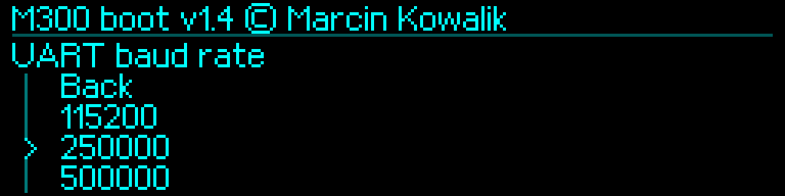

# UART and MCU handoff — M300Boot 1.4

[English](../../en/v1.4/uart-examples.md) · [Polski](../../pl/v1.4/uart-examples.md) · [Index](README.md)

## Five supported rates

The selectable and active rate set is exactly **115200, 250000, 500000, 750000, 1500000**, 8N1 without RTS/CTS. Empty settings use **250000**. UART on bootwait defaults to **OFF**. Supported saved rates retain their original journal encoding and are preserved through upgrade; default does not mean reset every saved supported choice.



## Set and save locally

1. Stop Klipper and every other client of the serial device.
2. Interrupt countdown with the knob and release it.
3. Select `Diagnostics → UART → UART baud rate`, choose a supported value and require confirmation of a successful Flash save.
4. Set `UART on bootwait → OFF` for normal operation with the Orange Pi.
5. Set the identical baud in the host configuration, then restart the printer normally without holding the knob. Start Klipper after its compatible MCU APP starts.

```ini
[mcu]
serial: /dev/ttyS1
baud: 250000
restart_method: command
```

`/dev/ttyS1` is the tested Orange Pi path, not a portable name. UART hardware, clock and device mapping must match the host. Installing BOOT does not modify the APP's UART reader or host configuration. For 1500000 use a compatible MCU/host bundle that supports the saved rate (UART8 or a later compatible implementation).


## Migration from removed rates

BOOT 1.4 maps an old stored **1000000, 19200 or 57600** to active **250000**, without silently rewriting the journal. A previously installed Klipper APP may still decode the old stored record independently. Before launching such an APP, explicitly select **250000** in BOOT, confirm its save, set the host to 250000 and restart. Do not assume a default display means that the old journal has already been replaced. Supported old records retain their meaning; the 1500000 code is not renumbered when the visible menu loses 1000000.

## Console and recovery

Use 3.3-V TTL, common GND and cross TX/RX. MCU signals are PA9/USART1_TX and PA10/USART1_RX, not physical header numbers. Use verified wiring. Hold the knob at power-on to enter temporary 250000 service mode; this does not overwrite the saved setting.

```sh
bash tools/KONSOLA_M300_v1.4.command --port /dev/cu.usbmodem14203 --baud 250000
bash tools/KONSOLA_M300_v1.4.command --port /dev/cu.usbmodem14203 --baud 1500000 --dump-all
```

Choose the example matching the active rate. Require version 1.4, `BOARD_CHECK OK`, `PONG` and READY. `INFO`, `PING`, `HELP`, `VERIFY`, fixed-region `DUMP` and history commands provide diagnostics. `UARTCHECK`/`UARTUPDATE` belong to the file-server protocol and should be issued through `ibtool.py`, not by manual binary entry. With bootwait OFF, enter service locally first. ON admits complete recognized diagnostic lines during countdown; binary Klipper probes do not cancel autostart. The intermediary independently uses temporary **250000**.
