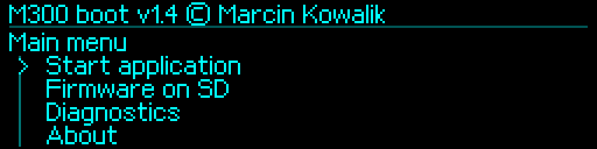

# Funkcje i konsola — M300Boot 1.4

[English](../../en/v1.4/features-and-console.md) · [Polski](../../pl/v1.4/features-and-console.md) · [Index](README.md)

## Menu i uruchamianie

Stały bootloader oraz instalator pośredni przedstawiają się jako **1.4**, bez dopisków rozwojowych. Kontener aktualizacji OEM ma odrębną wersję techniczną. OLED zachowuje natywne 256×64, czcionkę wzorowaną na oryginale, bezpośrednie kroki enkodera, ograniczone przewijanie i przypięte Back. Identyczne klatki są pomijane, a przesyłane są zmienione prostokąty.

| Pozycja główna | Przeznaczenie |
|---|---|
| Start application | Sprawdzenie i uruchomienie zainstalowanej APP |
| Firmware on SD | Wybór, kontrola i instalacja paczki APP |
| Diagnostics | Flash, Hardware, Reset/Recovery, enkoder, ekran, UART, SD i historia |
| About | Autor i wersja |
| Restart | Restart kontrolera |
| Backup Flash | Jawna kopia do przygotowanych plików |
| Service history | Odczyt historii lub jawny zapis na SD |

Odliczanie pięciu sekund rozpoczyna się po inicjalizacji. Fizyczna obsługa pokrętła pozwala wejść do serwisu. Przy bootwait OFF odbiór z hosta nie przerywa odliczania. ON dopuszcza wyłącznie pełne rozpoznane linie diagnostyczne; dane binarne, niepełne i zbyt długie nie odraczają startu. Przytrzymanie pokrętła przy włączaniu chwilowo wybiera serwisowe 250000.

## UART i zapis

Dokładnie **115200, 250000, 500000, 750000, 1500000**, domyślnie **250000/OFF**. Zmiana czeka na zakończenie nadawania starą prędkością i wymaga zweryfikowanego odczytu po zapisie Flash. Dzienniki ustawień są dopisywane; nie są automatycznie kasowane w celu odzyskania miejsca. Ponowny wybór rzeczywiście zapisanej bieżącej wartości nie zużywa pozycji. Dawne niedozwolone prędkości przechodzą na aktywne 250000 bez samoczynnej zmiany dziennika. Przed starszą APP mogącą nadal odczytywać usunięty rekord jawnie zapisz 250000. [Pełna procedura UART](uart-examples.md).

## Instalacja i diagnostyka

Paczki APP korzystają z jednego obszaru od **0x08008000**; zastąpienie BOOT jest osobną operacją instalatora. Zapis APP i ręczny start wymagają nowego przytrzymania 2 s; zmiana BOOT wymaga dwóch zweryfikowanych kopii oraz osobnego gestu zwolnienie/kliknięcie/zwolnienie/5 s. NVM producenta, pierwsze oryginalne 4 KiB oraz Option Bytes pozostają poza zwykłymi zapisami. [Kolejność instalacji](installation.md).

Diagnostyka konsoli obejmuje INFO, PING, HELP, VERIFY, CARDINFO, DISPLAY, DIAG i DUMP stałych obszarów. BACKUP/LOGSAVE jawnie zapisują SD; BOOT/REBOOT zmieniają stan kontrolera. Do kontroli, pakowania i aktualizacji M3B używaj `ibtool.py`. `serial` bez `--update` tylko sprawdza; jawna aktualizacja nadal wymaga fizycznego potwierdzenia. M3B zapewnia integralność SHA-256, a nie uwierzytelnienie podpisem. Samodzielne ekrany Klippera należą do jego APP MCU i są dostarczane przez odrębną paczkę Klippera.
