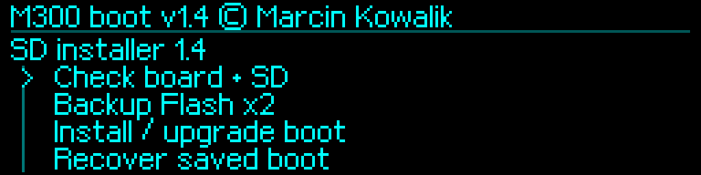
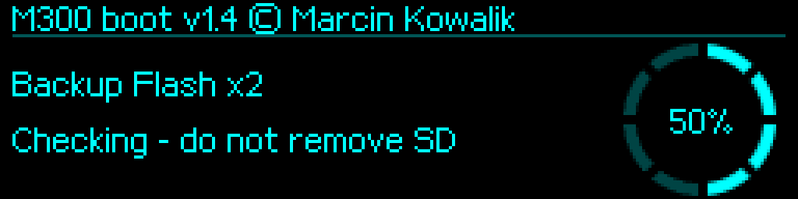

# Instalacja SD — M300Boot 1.4

[English](../../en/v1.4/installation.md) · [Polski](../../pl/v1.4/installation.md) · [Index](README.md)

## Wybierz drogę instalacji

**UPGRADE** służy do aktualizacji rozpoznanego własnego M300Boot; **FACTORY** do zakwalifikowanego oryginalnego OEM v3. Pobierz właściwą paczkę z [firmware/v1.4](../../../firmware/v1.4). Kontrole UID, opcji, danych fabrycznych, profilu i źródłowego BOOT pozostają obowiązkowe. Zatrzymaj Klippera oraz inne programy korzystające z UART.

## Przygotuj i sprawdź kartę

1. Najpierw wykonaj [niezależne kopie](original-backup.md) i zachowaj je na innym nośniku.
2. Sprawdź ZIP według [sum SHA-256 wydania](../../../firmware/v1.4/SHA256SUMS.txt). Rozpakuj do nowego folderu.
3. Skopiuj dokładnie sześć plików do katalogu głównego świeżej karty FAT32:

| Droga | Pliki w katalogu głównym karty |
|---|---|
| UPGRADE | `M300APP.M3B`, `RESTORE.BIN`, `M3FLASH.BIN`, `M3INFO.BIN`, `ZBACK2.BIN`, `ZINFO2.DAT` |
| FACTORY | `Update.bin`, `RESTORE.BIN`, `M3FLASH.BIN`, `M3INFO.BIN`, `ZBACK2.BIN`, `ZINFO2.DAT` |

Cztery pliki wypełnione A5 są szablonami, a nie kopiami: pliki Flash mają po 262144 B, informacyjne po 1024 B. Nie nadpisuj gotowych kopii szablonami. Nie umieszczaj na jednej karcie FACTORY `Update.bin` i M3B instalatora pośredniego.

```sh
python3 tools/verify_sd_i2.py --card "/Volumes/M300_CARD" --route upgrade
# Dla karty FACTORY użyj --route factory.
```

Wymagaj poprawnej kontroli karty dla 1.4. Rozdzielenie klastrów FAT sprawdza dodatkowo instalator w drukarce przed zapisem.

## Wgraj i uruchom instalator pośredni

**UPGRADE:** przerwij odliczanie pokrętłem i zwolnij je. Wybierz `Firmware on SD → Choose firmware file → M300APP.M3B`, sprawdź plik i zainstaluj go świeżym przytrzymaniem 2 s. Zweryfikuj Flash. Wybierz `Start application → Launch application` i potwierdź. APP zawiera teraz **SD installer 1.4**; stały BOOT jeszcze nie został zaktualizowany.

**FACTORY:** wyłącz drukarkę i włóż kartę FACTORY. OEM może od razu rozpocząć zapis `Update.bin` po włączeniu. Poczekaj na zakończenie, wyłącz drukarkę, wyjmij kartę i uruchom bez niej. Wymagaj **SD installer 1.4**. Techniczna wersja kontenera OEM jest niezależna od numeru 1.4 działającego instalatora. Włóż tę samą kartę w stabilnym menu instalatora.



## Zakończ zapis BOOT

1. `Check board + SD` → wymagaj `CHECK_SOURCE_CARD_RESTORE_OK`.
2. `Backup Flash x2` → wymagaj `PASS_SD_FULL_FLASH_X2` w tej samej sesji.
3. `Install / upgrade boot` → **zwolnienie → nowe kliknięcie → zwolnienie → nowe naciśnięcie i przytrzymanie 5 s**. Obrót anuluje.
4. Wymagaj `INSTALL_OK_STAGE2_AND_ASSETS_VERIFIED`. Zachowaj treść ewentualnej odmowy; nie usuwaj blokad ani nie zmieniaj skrótów tożsamości.
5. `Restart to boot`; przerwij odliczanie. Sprawdź wersję **1.4** BOOT.
6. Skopiuj cztery gotowe pliki kopii na inny nośnik i sprawdź: `python3 tools/verify_sd_i2.py --backups "/private/completed-backups"`.


### Fizyczne potwierdzenie BOOT i zakończenie

Poniżej rendery rzeczywistych ekranów wydania: postęp kopii, osobne przytrzymanie potwierdzające i zweryfikowane zakończenie. Przed wykonaniem przeczytaj pięcioetapowy gest powyżej.




## Przywróć APP przed zwykłym użyciem

**Po instalacji SD w APP pozostaje instalator pośredni.** Dla oryginalnego drukowania wybierz/sprawdź/zainstaluj/zweryfikuj `RESTORE.BIN`, a następnie uruchom aplikację. Ten plik nadal zawiera oryginalny **Zortrax M300 1.3.1**, niezależnie od BOOT 1.4.

Dla Klippera najpierw zastąp na karcie instalator `M300APP.M3B` plikiem aplikacji M3B z pasującej paczki MCU Klippera. Sprawdź/zainstaluj/zweryfikuj tę APP. Przed jej uruchomieniem wybierz i zapisz obsługiwaną prędkość UART zgodnie z opisem poniżej, a następnie uruchom aplikację. Paczki bootloadera nie zawierają zestawu MCU/host Klippera.

Po migracji z zapisanego 1000000, 19200 lub 57600 przed uruchomieniem starszej APP Klippera jawnie wybierz w BOOT **250000** i potwierdź zapis. Ustaw w hoście `[mcu] baud: 250000`. Zobacz [migrację UART](uart-examples.md). Zwykła praca hosta korzysta z bootwait OFF.

Zapewnij stabilne zasilanie podczas zapisu. BOOT nie ma automatycznego cofnięcia aktualizacji po utracie zasilania. Odzyskiwanie przez nadal działający instalator wymaga poprawnych kopii z tej sesji; [ST-Link](stlink-and-recovery.md) jest odrębną drogą.
