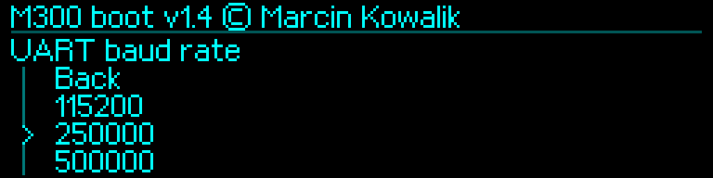
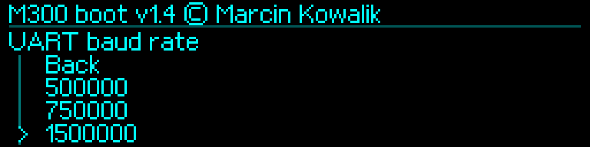
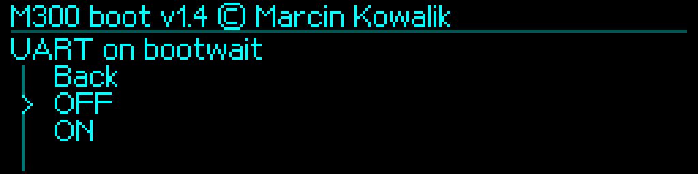

# UART i aplikacja MCU — M300Boot 1.4

[English](../../en/v1.4/uart-examples.md) · [Polski](../../pl/v1.4/uart-examples.md) · [Index](README.md)

## Pięć obsługiwanych prędkości

Zestaw prędkości dostępnych do wyboru i aktywnej pracy to dokładnie **115200, 250000, 500000, 750000, 1500000**, 8N1 bez RTS/CTS. Puste ustawienia oznaczają **250000**. Domyślny UART on bootwait to **OFF**. Obsługiwane wcześniej zapisy zachowują kody dziennika i są przenoszone podczas aktualizacji; wartość domyślna nie oznacza zerowania każdego poprawnego wyboru.



## Wybór i zapis lokalny

1. Zatrzymaj Klippera i pozostałe programy korzystające z portu.
2. Przerwij odliczanie pokrętłem i zwolnij je.
3. Wybierz `Diagnostics → UART → UART baud rate`, wskaż obsługiwaną wartość i wymagaj potwierdzenia zapisu Flash.
4. Dla zwykłej pracy z Orange Pi wybierz `UART on bootwait → OFF`.
5. Ustaw tę samą prędkość w hoście, uruchom drukarkę normalnie bez przytrzymywania pokrętła, a następnie Klippera po starcie zgodnej APP MCU.

```ini
[mcu]
serial: /dev/ttyS1
baud: 250000
restart_method: command
```

`/dev/ttyS1` to sprawdzona ścieżka Orange Pi, a nie nazwa uniwersalna. Sprzęt UART, jego zegar i mapowanie urządzenia muszą pasować do hosta. Instalacja BOOT nie zmienia czytnika UART w APP ani konfiguracji hosta. Dla 1500000 wymagany jest zgodny zestaw MCU/host, obsługujący zapis tej prędkości (UART8 lub późniejsza zgodna implementacja).




## Migracja z usuniętych prędkości

BOOT 1.4 interpretuje dawniej zapisane **1000000, 19200 lub 57600** jako aktywne **250000**, bez samoczynnego przepisywania dziennika. Wcześniej zainstalowana APP Klippera może niezależnie odczytać stary rekord. Przed jej uruchomieniem jawnie wybierz w BOOT **250000**, potwierdź zapis, ustaw host na 250000 i uruchom ponownie. Sam widok wartości domyślnej nie oznacza, że stary zapis został już zastąpiony. Obsługiwane rekordy zachowują znaczenie; kod 1500000 nie jest przesuwany po usunięciu 1000000 z menu.

## Konsola i odzyskiwanie łączności

Stosuj TTL 3,3 V, wspólną masę oraz skrzyżowane TX/RX. Sygnały MCU to PA9/USART1_TX i PA10/USART1_RX, a nie numery pinów złącza. Użyj sprawdzonego okablowania. Przytrzymaj pokrętło podczas włączania, aby wejść chwilowo w tryb serwisowy 250000; nie nadpisuje to ustawienia trwałego.

```sh
bash tools/KONSOLA_M300_v1.4.command --port /dev/cu.usbmodem14203 --baud 250000
bash tools/KONSOLA_M300_v1.4.command --port /dev/cu.usbmodem14203 --baud 1500000 --dump-all
```

Wybierz przykład zgodny z aktywną prędkością. Wymagaj wersji 1.4, `BOARD_CHECK OK`, `PONG` i READY. `INFO`, `PING`, `HELP`, `VERIFY`, `DUMP` stałych obszarów i polecenia historii służą diagnostyce. `UARTCHECK`/`UARTUPDATE` należą do protokołu serwera plików; używaj ich przez `ibtool.py`, zamiast ręcznie wpisywać dane binarne. Przy bootwait OFF wejdź do serwisu lokalnie. ON dopuszcza podczas odliczania pełne rozpoznane linie diagnostyczne; binarne próby Klippera nie przerywają autostartu. Instalator pośredni niezależnie korzysta chwilowo z **250000**.
