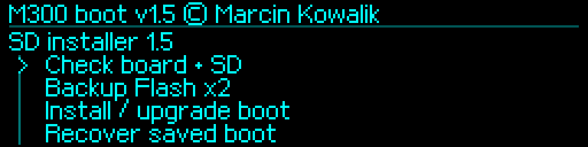
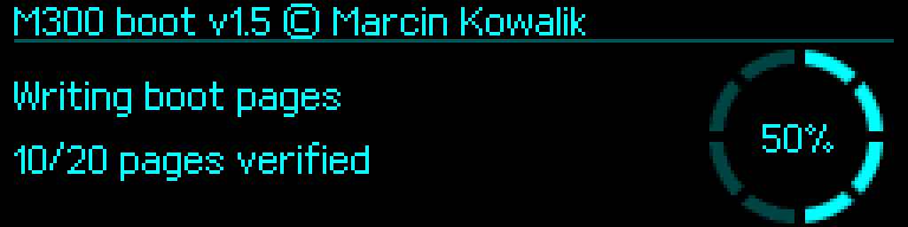
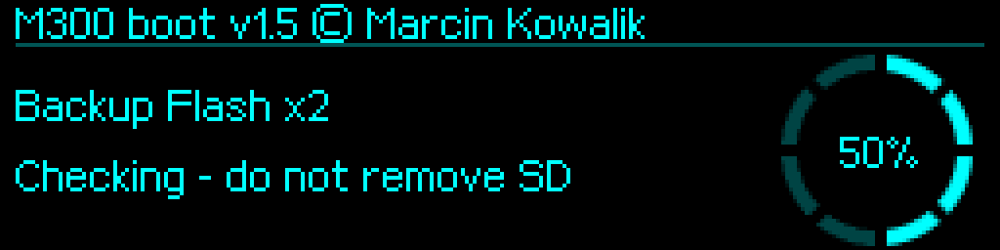
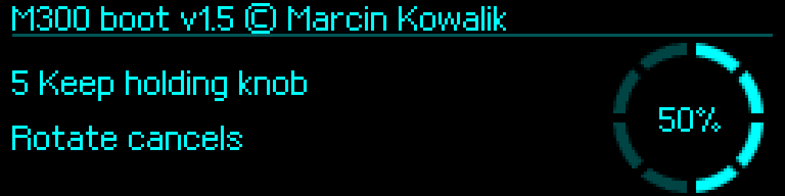
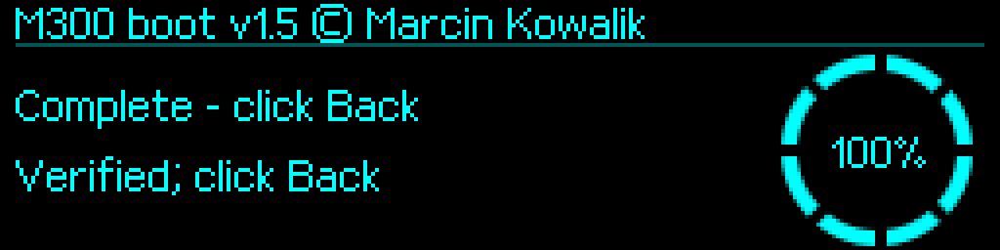

# Instalacja SD — M300Boot 1.5

[English](../../en/v1.5/installation.md) · [Polski](../../pl/v1.5/installation.md) · [Indeks](README.md)

Ilustracje w tym rozdziale wygenerowano za pomocą **renderera C wersji 1.5** z udokumentowanymi danymi przykładowymi. Pokazują aktualne menu, komunikaty i oryginalną czcionkę OLED; nie są zdjęciami ani dowodem wykonania operacji na drukarce. [Pochodzenie renderów i walidacja](../../assets/v1.5/README.md).

## Wybierz drogę instalacji

**UPGRADE** służy do aktualizacji rozpoznanego własnego M300Boot; **FACTORY** do zakwalifikowanego oryginalnego OEM v3. Pobierz właściwą paczkę z [firmware/v1.5](../../../firmware/v1.5). Kontrole UID, opcji, danych fabrycznych, profilu i źródłowego BOOT pozostają obowiązkowe. Zatrzymaj Klippera oraz inne programy korzystające z UART.

## Przygotuj i sprawdź kartę

1. Najpierw wykonaj [niezależne kopie](original-backup.md) i zachowaj je na innym nośniku.
2. Sprawdź ZIP według [sum SHA-256 wydania](../../../firmware/v1.5/SHA256SUMS.txt). Rozpakuj do nowego folderu.
3. Skopiuj dokładnie sześć plików do katalogu głównego świeżej karty FAT32:

| Droga | Pliki w katalogu głównym karty |
|---|---|
| UPGRADE | `M300APP.M3B`, `RESTORE.BIN`, `M3FLASH.BIN`, `M3INFO.BIN`, `ZBACK2.BIN`, `ZINFO2.DAT` |
| FACTORY | `Update.bin`, `RESTORE.BIN`, `M3FLASH.BIN`, `M3INFO.BIN`, `ZBACK2.BIN`, `ZINFO2.DAT` |

Cztery pliki wypełnione A5 są szablonami, a nie kopiami: pliki Flash mają po 262144 B, informacyjne po 1024 B. Nie nadpisuj gotowych kopii szablonami. Nie umieszczaj na jednej karcie FACTORY `Update.bin` i M3B instalatora pośredniego.

```sh
python3 tools/verify_sd_i2.py --card "/Volumes/M300_CARD" --route upgrade
# Dla karty FACTORY użyj --route factory.
```

Wymagaj poprawnej kontroli karty dla 1.5. Rozdzielenie klastrów FAT sprawdza dodatkowo instalator w drukarce przed zapisem.

## Wgraj i uruchom instalator pośredni

Przy zapisie APP i ręcznym uruchamianiu APP zwykły BOOT pokazuje `Release, then hold 2s`: zwolnij klik wyboru, następnie naciśnij ponownie i trzymaj nieprzerwanie 2 s. Nie wykonuj dodatkowego krótkiego kliknięcia między tym zwolnieniem a przytrzymaniem. Obrót anuluje. Osobny, opisany niżej gest 5 s instalatora BOOT zawiera dodatkowy krótki klik i zwolnienie.

**UPGRADE:** przerwij odliczanie pokrętłem i zwolnij je. Wybierz `Firmware on SD → Choose firmware file → M300APP.M3B`, sprawdź plik i zainstaluj go świeżym przytrzymaniem 2 s. Zweryfikuj Flash. Wybierz `Start application → Launch application` i potwierdź. APP zawiera teraz **SD installer 1.5**; stały BOOT jeszcze nie został zaktualizowany.

**FACTORY:** wyłącz drukarkę i włóż kartę FACTORY. OEM może od razu rozpocząć zapis `Update.bin` po włączeniu. Poczekaj na zakończenie, wyłącz drukarkę, wyjmij kartę i uruchom bez niej. Wymagaj **SD installer 1.5**. Techniczna wersja kontenera OEM jest niezależna od numeru 1.5 działającego instalatora. Włóż tę samą kartę w stabilnym menu instalatora.



## Zakończ zapis BOOT

Obsługa po stronie drukarki wymaga wyłącznie OLED-u i pokrętła; konsola UART jest opcjonalna. Obróć pokrętło, aby wybrać pozycję, i krótko naciśnij, aby ją wykonać. Po wyświetleniu wyniku **zwolnij pokrętło, a następnie wykonaj nowe krótkie kliknięcie**, aby wrócić do menu instalatora. Wynik nie znika automatycznie. Obracanie pokrętła nie zamyka ekranu wyniku.

| Krok | Czynność lokalna | Poprawny wynik na OLED | Opcjonalne potwierdzenie UART |
|---|---|---|---|
| 1 | `Check board + SD` | `Complete - click Back` / `Board and SD verified` | `CHECK_SOURCE_CARD_RESTORE_OK` |
| 2 | Nowy klik powrotu, następnie `Backup Flash x2` | `Complete - click Back` / `Backup x2 verified` | `PASS_SD_FULL_FLASH_X2` |
| 3 | Nowy klik powrotu, następnie `Install / upgrade boot` | Pięć komunikatów potwierdzenia, następnie `Writing boot pages` | `CONFIRM RELEASE_THEN_PRESS_RELEASE_THEN_HOLD_5S_ROTATE_CANCELS` |
| 4 | Poczekaj na zakończenie weryfikacji | `Complete - click Back` / `Verified; click Back` | `INSTALL_OK_STAGE2_AND_ASSETS_VERIFIED` |
| 5 | Nowy klik, następnie `Restart to boot`; przerwij odliczanie | Nagłówek BOOT zawiera `M300 boot v1.5` | `INFO` w BOOT podaje `M300BOOT v1.5` |

Krok trzeci wymaga **zwolnienia → nowego kliknięcia → zwolnienia → nowego naciśnięcia i przytrzymania 5 s**. Wykonuj polecenia `1 Release knob`, `2 Click knob once`, `3 Release after click`, `4 Press and hold 5s`, `5 Keep holding knob`. Obrót anuluje; zwolnienie podczas ciągłego przytrzymania anuluje; cała sekwencja potwierdzenia ma limit 45 s. Wymagana jest poprawna podwójna kopia wykonana w tej samej, nieprzerwanej zasilaniem sesji instalatora. Po wyłączeniu lub restarcie powtórz `Check board + SD` i `Backup Flash x2` przed kolejną próbą.

Jeżeli po restarcie bieżący Flash różni się od zachowanych kopii, stare pliki kopii nie kwalifikują nowego stanu: zachowaj je na innym nośniku i przygotuj świeże szablony na osobnej karcie. Plików odzyskiwania z działającej sesji po nieudanym zapisie nie wolno w tym celu zastępować.

Jeśli zapisany cel był już identyczny, OLED pokazuje `Already v1.5 - no write`, a opcjonalny UART `ALREADY_TARGET_V15_NO_BOOT_WRITES`; strony BOOT nie zostały ponownie zapisane. Zachowaj każdy ekran i numer błędu. Nie usuwaj blokad ani nie zmieniaj skrótów tożsamości.

Po zweryfikowanej instalacji wejdź do stabilnego menu BOOT, wyłącz drukarkę i wyjmij kartę, aby skopiować **wszystkie cztery** gotowe pliki kopii na inny nośnik. Sprawdź je poleceniem `python3 tools/verify_sd_i2.py --backups "/private/completed-backups"`. Zachowaj obie pary razem, pod oryginalnymi nazwami. Nie nadpisuj ich szablonami A5. Włóż kartę ponownie, włącz drukarkę i znów przerwij odliczanie przed przywracaniem APP.



### Fizyczne potwierdzenie BOOT i zakończenie

Poniższe rendery C ilustrują postęp kopii, osobne przytrzymanie potwierdzające i komunikat zakończenia, na podstawie danych przykładowych. Przed wykonaniem przeczytaj pięcioetapowy gest powyżej.







## Przywróć APP przed zwykłym użyciem

**Po instalacji SD w APP pozostaje instalator pośredni.** Dla oryginalnego drukowania jawnie wybierz `Firmware on SD → Choose firmware file → RESTORE.BIN`, następnie `Check selected file` i `Install selected file`. Wykonaj osobne świeże potwierdzenie 2 s, po czym użyj `Diagnostics → Verify Flash`. Na końcu wybierz `Start application → Launch application` i wykonaj odrębne świeże potwierdzenie 2 s. Nie polegaj na automatycznym wyborze pliku, gdy na karcie nadal jest M3B instalatora. Ten plik nadal zawiera oryginalny **Zortrax M300 1.3.1**, niezależnie od BOOT 1.5.

Dla Klippera najpierw zastąp na karcie instalator `M300APP.M3B` plikiem aplikacji M3B z pasującej paczki MCU Klippera. Sprawdź/zainstaluj/zweryfikuj tę APP. Przed jej uruchomieniem wybierz i zapisz obsługiwaną prędkość UART zgodnie z opisem poniżej, a następnie uruchom aplikację. Paczki bootloadera nie zawierają zestawu MCU/host Klippera.

Po migracji z zapisanego 1000000, 19200 lub 57600 przed uruchomieniem starszej APP Klippera jawnie wybierz w BOOT **250000** i potwierdź zapis. Ustaw w hoście `[mcu] baud: 250000`. Zobacz [migrację UART](uart-examples.md). Zwykła praca hosta korzysta z bootwait OFF.

Zapewnij stabilne zasilanie podczas zapisu. BOOT nie ma automatycznego cofnięcia aktualizacji po utracie zasilania. Odzyskiwanie przez nadal działający instalator wymaga poprawnych kopii z tej sesji; [ST-Link](stlink-and-recovery.md) jest odrębną drogą.

## Odzyskiwanie po przerwanym zapisie BOOT w działającej sesji

Ta droga służy wyłącznie do sytuacji, gdy ten sam instalator po próbie zapisu BOOT nadal działa, reaguje i pozostaje zasilany. Gdy widzisz `KEEP POWER - see UART`, **zachowaj zasilanie i tę samą kartę SD w drukarce**. Nie restartuj, nie wyjmuj karty ani nie przygotowuj nowych szablonów.

1. Zanotuj widoczny numer błędu. Zwolnij pokrętło i wykonaj nowe krótkie kliknięcie powrotu do menu instalatora.
2. Wybierz `Recover saved boot`. Instalator sprawdza obie gotowe kopie i zapamiętaną tożsamość sesji, wymaga tego samego gestu zwolnienie/klik/zwolnienie/ciągłe 5 s, a przed zapisem sprawdza kopie ponownie.
3. Poczekaj na `Complete - click Back` / `Verified; click Back`. Opcjonalny UART podaje `SAVED_SOURCE_RESTORED_VERIFIED`. Odmowa odzyskiwania nie oznacza zgody na wymuszony reset lub kasowanie; zachowaj jej treść i zasilanie podczas rozpoznawania przyczyny.
4. Po poprawnym odzyskaniu przywrócony jest poprzedni **BOOT**. W APP nadal znajduje się instalator; nie jest to przywrócenie oryginalnej aplikacji drukującej. Wróć nowym kliknięciem. Zweryfikowane źródło można uruchomić przez `Restart to boot`. Jeżeli źródłem był OEM, nie pozostawiaj `Update.bin` na karcie odczytywanej przez OEM przy następnym starcie; dopiero po zweryfikowanym zakończeniu odzyskiwania, gdy żaden zapis nie trwa, wyłącz drukarkę i wyjmij kartę aktualizacji przed ponownym uruchomieniem.

`Recover saved boot` odmawia działania przed próbą zapisu (`NO_LIVE_WRITE_TO_RECOVER`) i nie odtwarza poprzedniej sesji po resecie. Nie jest automatycznym powrotem po utracie zasilania. Gdy BOOT nie startuje albo instalator już nie działa, potrzebne są własne kompletne materiały odtworzeniowe i osobno sprawdzona [droga ST-Link](stlink-and-recovery.md).

## Ponowna instalacja APP po przerwanym zapisie metadanych

Ta funkcja dotyczy **APP przy działającym BOOT 1.5**, a nie przerwanego programowania samego BOOT. Jeśli kompletna APP została już zapisana, lecz końcowy zapis jej metadanych/znacznika commit został przerwany, `VERIFY` może zgłosić `NO_COMMIT`. Aplikacji nie wolno wtedy uruchamiać.

1. Zapewnij stabilne zasilanie, zachowaj kopie i użyj **tego samego, zweryfikowanego pakietu APP**, którego zapis przerwano. Nie zastępuj go przypadkowym obrazem stock ani inną wersją MCU.
2. W `Firmware on SD → Choose firmware file` wybierz właściwy plik, wykonaj `Check selected file`, następnie `Install selected file`. Dla transferu UART użyj tego samego pakietu przez `ibtool.py serial` z jawną opcją `--update`.
3. BOOT sprawdzi zgodność kandydata z przerwanym rekordem oraz skrót całej APP w pamięci. Dopiero zgodny przypadek może przejść do zwykłego fizycznego potwierdzenia: zwolnij pokrętło i wykonaj **nowe przytrzymanie 2 s**. Sprawdzenie pliku samo nie naprawia metadanych.
4. Poczekaj na zakończenie instalacji i weryfikacji. Wykonaj `Diagnostics → Verify Flash`; uruchom APP dopiero po poprawnym wyniku i zwykłym osobnym potwierdzeniu startu.

To ponowna kontrolowana instalacja, nie automatyczna akceptacja brakującego commit. **Niezgodny zapis metadanych, inny kandydat lub uszkodzona APP nadal powodują odmowę.** Nie czyść ręcznie metadanych i nie omijaj kontroli. Ten mechanizm nie przywraca obrazu po dowolnym zaniku zasilania w środku programowania APP i nie zapewnia rollbacku.

Jeśli działa jeszcze stary BOOT 1.4 i odrzuca już instalację przez `NO_COMMIT`, jego standardowa droga SD może nie wgrać także instalatora 1.5. Standardowy plan ST-Link wymaga poprawnej APP. Zachowaj kopie i użyj [osobnej oceny odzyskania](stlink-and-recovery.md#starsza-wersja-zatrzymana-w-no_commit), bez usuwania warunków zwykłego preflightu.
